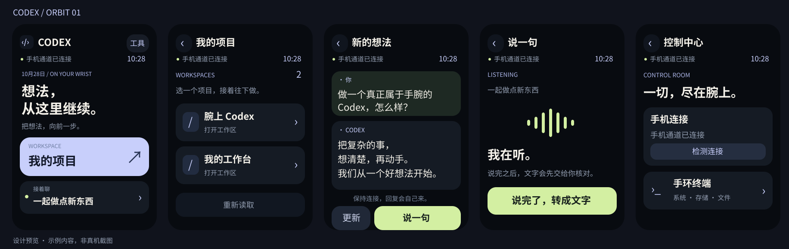
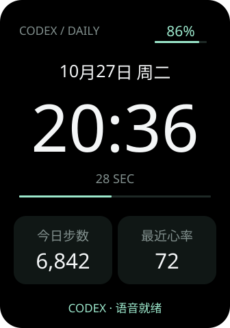
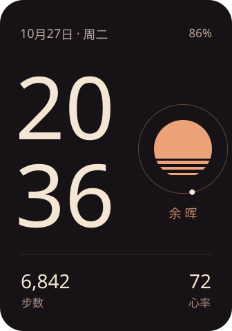
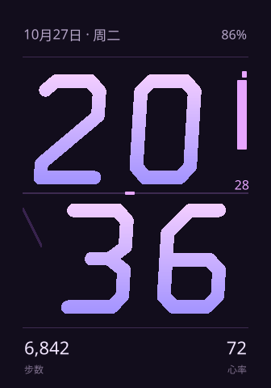
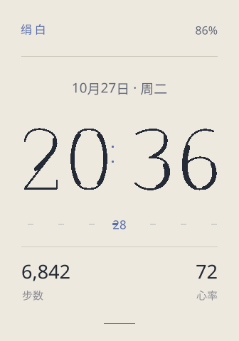

# 腕上 Codex · ORBIT

让小米手环 10 Pro 连接安卓手机 Termux 中的 Codex：读对话、原生录音、确认发送，以及远程管理手环。

**支持基线：M2551B1 / 固件 3.101.043 / ORBIT RPK 0.4.3。**
这是从实际设备项目整理的公开源码版，采用 MIT 许可。其他型号和固件尚未适配。

## 能做什么

- 项目、会话与消息阅读；对话打开时接收分段回复。
- 在自己的 App 内开始和结束录音，无需打开系统录音机。
- 原生音频经蓝牙回传，手机解码、转写，手环显示草稿，用户核对后确认发送。
- 手机 Termux 输入 NSH 命令，在手环 NuttX 上执行并返回状态和输出。
- 自有 App 私有目录内的双向文件传输、校验、断线续传，单文件上限 1 MiB。
- 经标准厂商协议安装 RPK 和表盘，日常不需要 AstroBox 或旧伴侣 APK。
- Mint、余晖、流光、棱镜、绢白五款数字表盘；显示时间日期、电量及已有健康数据。

## 怎么组成

~~~mermaid
flowchart LR
  Dial[数字表盘] --> Display[时间与已有健康数据]
  App[ORBIT 手环 App] <--> Native[原生音频 / NSH / Link]
  Native <-->|专用蓝牙 UUID / SCN11| Phone[Termux 连接服务]
  Phone <--> Relay[本机业务桥接]
  Relay <--> Codex[已有 Codex App Server]
  Relay --> ASR[手机解码与转写]
  ASR --> Draft[手环核对草稿]
  Phone -.安装 / 恢复 / 页面唤醒.-> Factory[原厂 SCN5]
~~~

日用表盘只负责展示；原生服务独立于 App 页面。退出 App 后，手机仍可执行文件和 Shell 操作。
官方运动健康与 MiWearCore 保留原设置。当前手机字节管道依赖已授权的本机 ADB。

## 数字表盘

| Mint | 余晖 | 流光 | 棱镜 | 绢白 |
| --- | --- | --- | --- | --- |
|  |  |  |  |  |

这些是设计预览，实际数据来自设备订阅。

## 从哪里开始

| 需求 | 入口 |
| --- | --- |
| 让另一个 agent 接手 | [AGENTS.md](AGENTS.md) |
| 新设备安装和配置 | [完整部署说明](docs/SETUP.md) |
| 了解模块职责 | [架构](docs/ARCHITECTURE.md) |
| 日常命令、重启恢复 | [运行维护](docs/OPERATIONS.md) |
| 蓝牙、文件、音频协议 | [协议说明](docs/PROTOCOL.md) |
| 验证范围与未解决事项 | [验证记录](docs/VALIDATION.md) |
| 密钥与发布边界 | [安全说明](SECURITY.md) |

只看代码或做离线开发：

~~~sh
git clone https://github.com/NoobMaster233/wrist-codex.git
cd wrist-codex
npm ci
npm test
python scripts/test-native.py
python scripts/check-publication.py
~~~

接入设备需要**你自己手环的厂商认证材料**。仓库不含任何设备密钥，也没有宣称能在未 root 的官方运动健康 App 中自动导出密钥。
缺少这个前置条件时，可以开发、构建和跑离线测试，但不能直接连接手环。详见部署说明。

## 目录

~~~text
band/                         ORBIT RPK 源码与构建依赖
bridge/                       本机桥接、Codex、语音、文件与蓝牙协议
phone/termux-bt/               Android shell 字节管道 Java 源码
phone-research/native-audio/   .043 原生音频、NSH、Link 与管理协议源码
resources/native/3.101.043/    三个已在原设备验证的模块及哈希
device-probe/                 表盘 Lua 与受保护恢复模板
assets/                       原创图标、数字与表盘预览
scripts/                      构建、配置、检查及运行入口
test/                         合成数据与离线测试
docs/                         部署、架构、协议、验证
~~~

## 当前边界

- 录音最长 24 秒，结束后传完整文件；没有逐字语音流。
- 回复按事件分段推送；连接及页面恢复仍可能延迟。
- Termux 仍可能被 Android 回收，完整的自动恢复与长期后台可靠性尚未完成。
- 转写适配器使用实验性的 ChatGPT 会话接口，**不属于承诺稳定的官方音频 API**，账号或服务变更可能使它失效。
- 新设备首装需要按实际上传回执生成加载器。公开首装流程完成离线检查，但尚未在第二只恢复出厂的手环上重新验收。
- 原生模块绑定 .043 固件地址，不能用于名称相近的其他固件。
- 标准蓝牙安装可用；不把它等同于已经完成“脱离手机的通用 NSH 离线安装器”。

原设备已完成真人语音确认发送、11 项 NSH 和双向 131075 B 文件断线续传。
公开版的配置与构建适配、离线测试和原设备历史验收在 [验证记录](docs/VALIDATION.md) 中分别说明。

## 许可

[MIT](LICENSE)。依赖和设备自带组件保留各自许可，见 [第三方说明](THIRD_PARTY_NOTICES.md)。
本项目与 Xiaomi、OpenAI 无隶属或官方合作关系。
